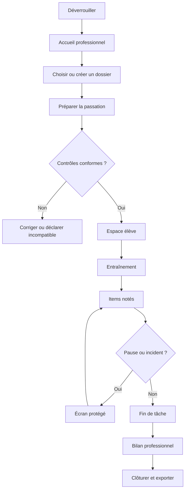

# Maquettes fonctionnelles et système d’interface

**Statut : maquettes basse fidélité validées pour préparer la production**
**Nature :** spécification non fonctionnelle ; aucun code de production.

## 1. Direction visuelle

BCN utilise une esthétique calme, professionnelle et rassurante :

- fond principal : gris très clair ;
- surfaces : blanc ;
- texte : bleu nuit ;
- action principale : bleu pétrole ;
- focus : jaune foncé entouré de bleu nuit ;
- erreur : rouge sombre avec texte et icône ;
- avertissement : ambre avec texte ;
- succès professionnel : vert sombre avec texte ;
- espace élève sans couleurs de réussite ou d’échec.

Palette initiale à vérifier par test de contraste :

| Usage | Couleur |
|---|---|
| texte principal | #102A43 |
| texte secondaire | #334E68 |
| fond | #F5F7FA |
| surface | #FFFFFF |
| action principale | #00657A |
| action survol | #004E60 |
| focus | #F2B705 |
| erreur | #A61B1B |
| avertissement | #8A4B00 |
| succès professionnel | #176B3A |
| bordure | #BCCCDC |

Police : pile système sans empattement. Aucun téléchargement de police.

## 2. Gabarit professionnel ordinateur

| Zone | Position | Contenu |
|---|---|---|
| en-tête | pleine largeur, 64 px | BCN, profil actif, verrouiller |
| navigation | gauche, 240 px | Accueil, Dossiers, Rapports, Administration, Aide |
| fil d’Ariane | haut du contenu | position et retour |
| titre | début du contenu | titre, statut, action principale |
| contenu | colonne centrale | formulaires, tableaux, synthèses |
| panneau contextuel | droite, facultatif | contrôles, aide ou résumé |
| messages | sous le titre | erreurs et avertissements |
| pied | bas | version, hors connexion, sauvegarde |

À 200 % de zoom, la navigation devient un bouton et le panneau contextuel passe sous le contenu.

## 3. Gabarit tablette

- en-tête de 64 px ;
- navigation dans un panneau latéral fermé par défaut ;
- contenu sur une colonne ;
- boutons principaux sur toute la largeur lorsque nécessaire ;
- aucun tableau horizontal indispensable : transformation en cartes étiquetées ;
- orientation paysage obligatoire uniquement pour les tâches qui l’exigent.

## 4. Gabarit espace élève

| Zone | Contenu |
|---|---|
| bandeau discret | nom de la tâche et progression neutre facultative |
| consigne | texte large, bouton Réécouter si autorisé |
| zone principale | tâche, sans navigation professionnelle |
| zone inférieure | commande Continuer uniquement hors item chronométré |
| sortie protégée | raccourci professionnel non visible comme action ordinaire |

Aucun nom, résultat, menu, horloge ou bouton administratif.

## 5. Parcours principal

## 6. M01 — Déverrouillage

### Contenu

- logo texte BCN ;
- mention « Données conservées sur cet appareil » ;
- champ phrase maîtresse ;
- bouton Ouvrir le coffre ;
- lien Récupération administrateur ;
- version de l’application ;
- état hors connexion.

### États

- coffre neuf : créer la phrase et la clé de récupération ;
- coffre existant ;
- phrase incorrecte ;
- temporisation ;
- format à migrer ;
- données corrompues ;
- navigateur incompatible.

Aucune donnée de jeune n’est visible.

## 7. M02 — Accueil professionnel

### Priorité visuelle

1. Reprendre une passation ;
2. Nouvelle passation ;
3. dossiers récents pseudonymisés ;
4. alertes de sauvegarde ou compatibilité ;
5. activité récente.

Cartes recommandées :

| Carte | Information | Action |
|---|---|---|
| en cours | code, tâche, date | Reprendre |
| à préparer | code, modules | Continuer |
| sauvegarde | dernière sauvegarde | Sauvegarder |
| stockage | espace et persistance | Vérifier |

Aucune statistique comparant les jeunes.

## 8. M03 — Liste et fiche dossier

### Liste

- recherche par code ;
- filtres niveau, statut, période ;
- colonnes : code, âge, niveau, dernière passation, statut ;
- action Ouvrir ;
- création Nouvelle fiche.

### Fiche

- code ;
- âge en années et mois ;
- niveau scolaire ;
- échéance de conservation ;
- passations ;
- observations administratives minimisées ;
- actions : nouvelle passation, archiver, corbeille.

Aucun champ de nom ou prénom.

## 9. M04 — Assistant de passation

Indicateur d’étapes :

1. Dossier ;
2. Tâches ;
3. Matériel ;
4. Adaptations ;
5. Vérifications ;
6. Récapitulatif.

Chaque étape possède Précédent, Enregistrer et continuer, Quitter. Le récapitulatif montre toutes les décisions modifiant la comparabilité.

## 10. M05 — Contrôle matériel

Liste de contrôle avec trois états textuels : Conforme, À confirmer, Bloquant.

Contrôles :

- navigateur ;
- hors connexion ;
- stockage ;
- écran et orientation ;
- zoom ;
- clavier ;
- pointeur ;
- son ;
- calibration ;
- espace libre ;
- mise à jour.

Une ligne bloquante explique l’action nécessaire. Le bouton Démarrer reste désactivé avec raison visible.

## 11. M06 — Calibration par carte

Disposition :

- consigne courte ;
- illustration d’une carte ID-1 sans marque ;
- rectangle réglable ;
- largeur et hauteur physiques de référence affichées ;
- boutons −, + et saisie fine ;
- bouton La taille correspond ;
- contrôle de cohérence ;
- résumé écran, orientation, zoom et facteur.

La calibration ne peut pas être validée hors tolérance technique.

## 12. M07 — Consigne et entraînement

Écran élève :

- pictogramme simple facultatif ;
- une phrase d’action ;
- bouton Écouter ou Réécouter selon la règle ;
- bouton Commencer l’entraînement ;
- zone de démonstration distincte.

Après entraînement :

- explication factuelle ;
- Réessayer une fois ;
- Continuer.

Après le second échec, le professionnel confirme la réserve depuis un écran protégé.

## 13. M08 — Frappe

### Copie

- texte modèle dans un panneau stable ;
- zone de saisie large ;
- aucun compteur visible ;
- aucun soulignement automatique ;
- focus initial explicite.

### Dictée

- zone de saisie ;
- audio lancé automatiquement après validation professionnelle ;
- aucune commande pause ou répétition ;
- indicateur neutre « Dictée en cours ».

### Manipulation

- document simulé ;
- une seule consigne à la fois ;
- outils strictement nécessaires ;
- pas de retour de réussite pendant l’item.

## 14. M09 — Pointage

- zone plein écran contrôlée ;
- marque de départ centrale ou dans un coin ;
- cible pleine très contrastée ;
- aucune décoration ;
- pointeur système conservé ;
- transition neutre de courte durée ;
- sortie professionnelle protégée.

Glisser-déposer : objet plein, destination en contour.

## 15. M10 — Repérage visuel

- consigne écrite et audio au-dessus de l’interface ;
- interface simulée bureau–fichiers ou document–outils ;
- densité conforme à l’item ;
- une sélection termine l’item ;
- aucune surbrillance après la réponse ;
- transition neutre.

## 16. M11 — Compréhension et navigation

### Compréhension

- consigne ;
- interface simulée ;
- une sélection ;
- aucun chronomètre visible.

### Navigation

- objectif persistant en haut ;
- interface simulée cohérente ;
- chemins alternatifs possibles ;
- aucun fichier réel ;
- état du scénario sauvegardé après chaque étape validée.

## 17. M12 — Pause et intervention

Écran élève de pause :

- « La tâche est en pause » ;
- fond neutre ;
- aucune donnée ;
- aucune commande de reprise visible.

Écran professionnel après authentification :

- Reprendre ;
- Enregistrer une aide ;
- Déclarer un incident ;
- Arrêter l’item ;
- Abandonner la tâche.

Chaque action affiche sa conséquence avant validation.

## 18. M13 — Reprise après incident

Résumé :

- tâche ;
- dernier item complet ;
- incident ;
- état matériel ;
- validité de la calibration ;
- données déjà conservées.

Une seule recommandation principale :

- reprendre ;
- remplacer l’item ;
- recommencer la tâche ;
- clôturer partiellement.

Le professionnel peut choisir une autre option autorisée avec motif.

## 19. M14 — Bilan professionnel

En-tête :

- code jeune ;
- âge et niveau ;
- statut ;
- dates ;
- condition ;
- matériel.

Onglets ou sections :

1. Synthèse ;
2. Frappe ;
3. Pointage ;
4. Repérage ;
5. Compréhension et navigation ;
6. Aides et incidents ;
7. Observations ;
8. Versions et historique.

Chaque tâche utilise une carte compacte :

| Bande | Contenu |
|---|---|
| titre | tâche, statut, comparabilité |
| résultats | indicateurs principaux |
| détails | erreurs et temps |
| contexte | dispositif et adaptation |
| qualité | aides, incidents, réserves |
| observation | zone professionnelle distincte |

## 20. M15 — Export

- choisir PDF ou CSV ;
- résumé des données incluses ;
- rappel « fichier enregistré localement » ;
- choix de l’emplacement ;
- avertissement si texte libre ;
- bouton Enregistrer ;
- confirmation avec empreinte et chemin non sensible.

Aucun bouton Envoyer, Partager ou Cloud.

## 21. M16 — Sauvegarde

- dernière sauvegarde ;
- état du stockage navigateur ;
- bouton Créer une sauvegarde locale ;
- choix de destination ;
- contrôle de l’intégrité ;
- test de restauration ;
- avertissement visible si la sauvegarde reste sur le même appareil.

## 22. M17 — Administration

Sections :

- profils ;
- sécurité ;
- contenus et versions ;
- conservation ;
- sauvegarde ;
- audit ;
- compatibilité.

Les opérations destructrices sont isolées et jamais regroupées avec les actions courantes.

## 23. M18 — Erreurs

### Récupérable

Titre simple, cause, données conservées, action Reprendre.

### Bloquante

- identifiant local d’incident ;
- dernière écriture validée ;
- action Fermer en sécurité ;
- export local d’un diagnostic sans donnée d’élève.

### Incompatibilité

- composant concerné ;
- raison ;
- tâche affectée ;
- solution ;
- possibilité de poursuivre les autres tâches.

## 24. Composants communs

- bouton principal unique par zone ;
- bouton secondaire ;
- bouton destructif ;
- champ ;
- sélection ;
- tableau accessible ;
- carte de résultat ;
- badge textuel de statut ;
- bannière ;
- dialogue ;
- étape de progression ;
- accordéon ;
- onglets accessibles ;
- notification non intrusive.

Tous les composants possèdent états clavier, tactile, focus, erreur, désactivé et chargement.

## 25. Règles responsive

- ordinateur : navigation latérale et contenu maximal de 1 200 px ;
- tablette paysage : navigation escamotable ;
- tablette portrait : une colonne ;
- téléphone : consultation et préparation seulement ;
- tâche calibrée : aucune redistribution modifiant la géométrie ; incompatibilité si espace insuffisant.

## 26. Validation des maquettes

Contrôles effectués au niveau fonctionnel :

- toutes les fonctions du parcours disposent d’un écran ;
- espace professionnel et espace élève séparés ;
- aucune identité civile ;
- aucun résultat présenté au jeune ;
- aucun partage cloud ;
- erreurs, pause, verrouillage et reprise couverts ;
- opérations destructrices confirmées ;
- accessibilité prévue dans les composants ;
- tablette et ordinateur couverts.

Restent à confirmer pendant les essais utilisateurs :

- compréhension exacte des libellés ;
- densité perçue ;
- tailles finales ;
- palette après audit ;
- effet de l’indicateur de progression.
