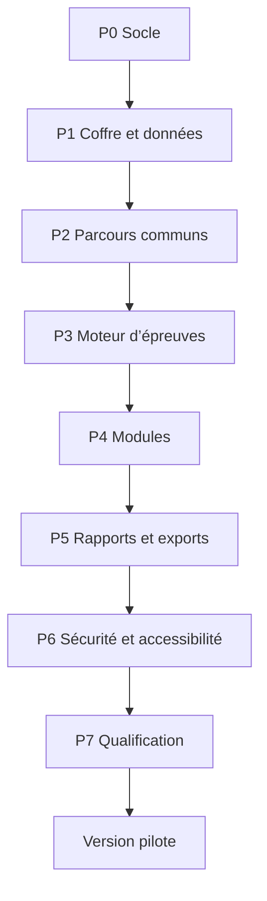

# Backlog de production ordonné

**Statut : prêt pour estimation, non autorisé à démarrer**
**Principe :** chaque lot produit un incrément vérifiable avec données fictives.

## 1. Ordre général

## 2. P0 — Socle

### P0-01 Initialiser le projet

Livrables : TypeScript strict, React, Vite, formatage, lint, tests, build.

Acceptation : build reproductible, aucune erreur, versions verrouillées, aucune dépendance inutile.

### P0-02 PWA hors connexion

Livrables : manifeste, service worker, cache des ressources.

Acceptation : installation puis redémarrage sans réseau ; aucune mise à jour pendant une passation.

### P0-03 Qualité continue

Livrables : tests, analyse de dépendances, contrôle des secrets, artefacts.

Acceptation : échec du pipeline si test, sécurité ou build échoue.

## 3. P1 — Coffre et données

### P1-01 Schémas du domaine

Implémenter le dictionnaire et ses validations.

Acceptation : données valides acceptées, champs inconnus sensibles rejetés.

### P1-02 Chiffrement local

Clé de données, enveloppement, dérivation, AES-GCM.

Acceptation : base copiée illisible coffre fermé ; aucune clé dans localStorage.

### P1-03 Authentification et verrouillage

Phrase maîtresse, profil, temporisation, 30 minutes.

Acceptation : cinq échecs ralentis ; clés retirées au verrouillage.

### P1-04 Persistance transactionnelle

IndexedDB, événements, lots atomiques.

Acceptation : coupure simulée sans état partiel.

### P1-05 Migrations

Version de schéma et moteur de migration.

Acceptation : migrations testées, version future refusée sans modification.

### P1-06 Sauvegarde et restauration

Conteneur chiffré local.

Acceptation : restauration valide, corruption refusée, aucun écrasement silencieux.

## 4. P2 — Parcours communs

### P2-01 Coquille professionnelle

Navigation, accueil, verrouillage, responsive.

Acceptation : clavier complet, zoom 200 %, aucune donnée après verrouillage.

### P2-02 Dossiers nominatifs

Nom, prénom, âge, niveau, conservation.

Acceptation : identité chiffrée, aucun envoi réseau, validation des champs.

### P2-03 Assistant de passation

Tâches, matériel, adaptations, récapitulatif.

Acceptation : impossible de démarrer si contrôle bloquant.

### P2-04 Préflight

Réseau, stockage, écran, son, entrées, version.

Acceptation : statut conforme, avertissement ou incompatible pour chaque contrôle.

### P2-05 Séances

Démarrage, pause, reprise, plusieurs jours.

Acceptation : temps de pause exclu et état exact après fermeture.

### P2-06 Aides et incidents

Catégories, motifs, effets.

Acceptation : aide liée à l’item et jamais comptée autonome.

## 5. P3 — Moteur d’épreuves

### P3-01 Machine d’état

Entraînement, départ, item, transition, pause, fin.

Acceptation : transitions interdites refusées ; état journalisé.

### P3-02 Chronométrage

Horloge monotone, durées actives.

Acceptation : tolérances de la stratégie de tests.

### P3-03 Gestion des contenus

Paquets versionnés, seed, empreintes.

Acceptation : une passation conserve exactement son contenu.

### P3-04 Audio

Lecture de fichiers locaux, répétition contrôlée.

Acceptation : règles propres à chaque tâche respectées hors connexion.

### P3-05 Calibration

Métadonnées fiables ou carte ID-1.

Acceptation : tolérances atteintes ou tâche incompatible.

### P3-06 Calculs

Moteur pur des indicateurs.

Acceptation : tous les jeux d’or donnent les résultats documentés.

## 6. P4 — Modules

### P4-01 Copie

Acceptation : textes, minuterie 5 min, événements et trois modes.

### P4-02 Dictée

Acceptation : audio 3 min, aucune pause/répétition, arrêt documenté.

### P4-03 Manipulation de texte

Acceptation : sélection, correction, copier-coller et critères exacts.

### P4-04 Clic/toucher

Acceptation : dix cibles, tailles, distances, directions, erreurs.

### P4-05 Double activation

Acceptation : intervalle brut, reconnaissance, incompatibilité.

### P4-06 Glisser-déposer

Acceptation : centre dans cible, précision en mm.

### P4-07 Repérage visuel

Acceptation : deux interfaces, densités, remplacement d’incident.

### P4-08 Compréhension

Acceptation : six items, une réponse, pas de temps affiché.

### P4-09 Navigation

Acceptation : quatre scénarios, chemins alternatifs, étapes et aides.

## 7. P5 — Bilan et fichiers

### P5-01 Bilan écran

Acceptation : tableaux par tâche, mesures et observations séparées.

### P5-02 PDF nominatif

Acceptation : identité correcte, chiffres reproductibles, PDF accessible.

### P5-03 CSV professionnel

Acceptation : quatre fichiers conformes, UTF-8, manifeste et types.

### P5-04 Export d’étude distinct

Acceptation : aucun identifiant local ou texte libre.

### P5-05 Audit

Acceptation : actions sensibles tracées sans contenu de bilan.

## 8. P6 — Durcissement

### P6-01 Accessibilité

Acceptation : critères du document d’interface et audit représentatif.

### P6-02 Sécurité applicative

Acceptation : CSP, injections, dépendances, import et droits testés.

### P6-03 Zéro réseau de données

Acceptation : aucune transmission détectée dans tous les parcours.

### P6-04 Résilience

Acceptation : scénarios de coupure, quota, stockage effacé et reprise.

### P6-05 Performance

Acceptation : interaction fluide sur matériel minimal et mesures stables.

## 9. P7 — Qualification

### P7-01 Matrice appareils

Acceptation : chaque combinaison qualifiée ou explicitement exclue.

### P7-02 Recette fonctionnelle

Acceptation : tous les critères liés aux quatre modules.

### P7-03 Jeux d’or

Acceptation : 100 % des calculs critiques.

### P7-04 Documentation

Acceptation : manuel expérimental, aide, sécurité, sauvegarde.

### P7-05 Version candidate

Acceptation : aucun défaut critique/majeur et fiche de qualification.

### P7-06 Première vague

Trois élèves, analyse et corrections bloquantes.

### P7-07 Pilote initial

Environ douze élèves du CM1 à la 3e, analyse descriptive et décision.

## 10. Définition de terminé

Une tâche est terminée si :

- critères d’acceptation réussis ;
- tests ajoutés ;
- accessibilité contrôlée ;
- aucune transmission de données ;
- documentation mise à jour ;
- revue effectuée ;
- aucun défaut critique ou majeur connu ;
- version et changement consignés.

## 11. Interdictions pendant la production

- ajouter une fonction exclue ;
- utiliser une donnée réelle dans les tests ;
- changer une formule sans version ;
- modifier silencieusement un contenu ;
- contourner un test bloquant ;
- ajouter un service cloud ;
- afficher une norme non validée ;
- publier une version pilote non qualifiée.
